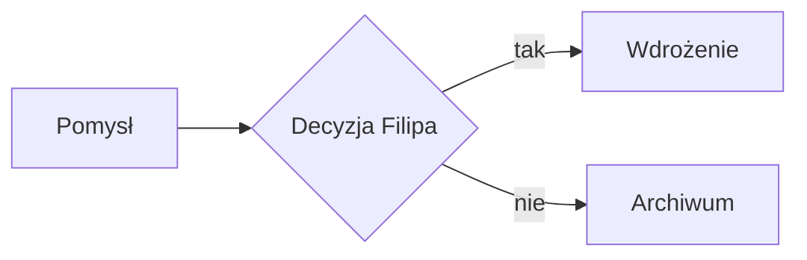

# Snippety (kopiuj i wklejaj w Nextcloud Text)

Gotowe bloki zamiast bloków Notiona. W Text wpisz `/`, żeby wstawić link do karty Deck, tabeli, strony albo pliku.

## Callout (info / wskazówka / uwaga / błąd)

> [!info] Informacja

> [!tip] Wskazówka

> [!warning] Uwaga

> [!error] Problem

## Rozwijany blok (toggle)

Kliknij, żeby rozwinąć

Treść ukryta.

## Lista zadań

- [ ] Zadanie
- [x] Zrobione

## Tabela decyzji

| Opcja | Plusy | Minusy |
|---|---|---|
| A |  |  |

## Diagram

## Wzór

$$
E = mc^2
$$
